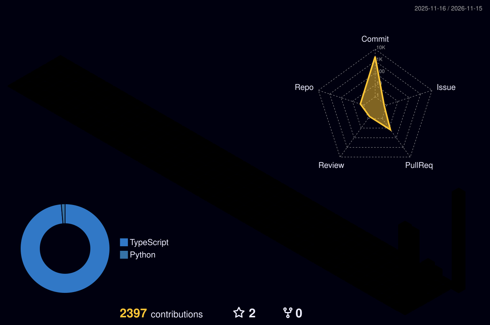

<a name="top"></a>

<div align="center">
  
</div>

<div align="center">
  
  
  
  
</div>

<br />

<div align="center">
  <a href="#about"></a>
  <a href="#workflows"></a>
  <a href="#skills"></a>
  <a href="#stats"></a>
  <a href="#contrib"></a>
  <a href="#projects"></a>
  <a href="#journey"></a>
  <a href="#contact"></a>
</div>

<div align="center">
  
</div>

<a name="about"></a>

## 01 — Về mình

Xin chào 👋 Mình là **Standardize Paradigm**, học sinh **lớp 7** ở Long Xuyên, An Giang. Mình học code vì **nó vui thật sự**: bắt đầu từ một dòng `print("Hello World")`, rồi mò dần sang web, game và chatbot. Học được một thứ là lại thấy mười thứ khác muốn thử 🚀

```yaml
role:       Học sinh lớp 7 · Lập trình viên tự học
location:   Long Xuyên, An Giang, Việt Nam (UTC+7)
learning:   [Python, JavaScript, Web, "mọi thứ trông thú vị"]
superpower: học nhanh + không sợ code lỗi
motto:      "Cứ thử đi, sai thì học được nhiều hơn"
```

- 🌱 &nbsp;**Đang học:** Python, JavaScript, HTML/CSS và tự làm web nho nhỏ
- 🛠️ &nbsp;**Đang xây:** game mini, tool tiện tay, vài project "để cho vui"
- 🎯 &nbsp;**Mục tiêu năm nay:** 3 project tử tế + code sạch hơn + 1 pull request open-source
- 💬 &nbsp;**Hỏi mình về:** Python, HTML/CSS, cách bắt đầu code khi còn đi học

> [!NOTE]
> Mình còn nhỏ, code còn nhiều chỗ chưa tối ưu — thấy gì cần sửa thì mở issue chỉ mình nhé. Mình rất thích được góp ý 🙌

<div align="right"><a href="#top">🔝 &nbsp;Về đầu trang</a></div>

<div align="center">
  
</div>

<a name="workflows"></a>

## 02 — Workflows tự động

Toàn bộ hình lớn trên trang — ảnh bìa, thẻ thống kê, đồng hồ, biểu đồ 3D — đều do **GitHub Actions tự vẽ và commit ngay vào repo**: không gọi server bên thứ ba, không bao giờ bị rate-limit hay 503. Chi tiết từng bước: [docs/WORKFLOWS.md](./docs/WORKFLOWS.md)

<div align="center">
  
</div>

<br />

<table>
  <tr>
    <td width="52"><b>🎨</b></td>
    <td><b>GitHub Profile 3D Contrib</b><br /><sub><code>.github/workflows/profile-3d.yml</code></sub></td>
    <td width="300">Biểu đồ contribution khối 3D, 10 giao diện màu. Có cổng thông minh: chỉ vẽ lại khi có push mới hoặc đã quá 24 giờ.</td>
    <td width="180"><b>Mỗi 5 phút</b> · <code>*/5 * * * *</code></td>
  </tr>
  <tr>
    <td><b>📊</b></td>
    <td><b>Profile Cards (LTS)</b><br /><sub><code>profile-cards.yml</code> + <code>scripts/generate_cards.py</code></sub></td>
    <td>Vẽ <code>stats.svg</code>, <code>top-langs.svg</code>, <code>hero.svg</code>, <code>activity.svg</code> bằng dữ liệu thật; chế độ <code>--smart</code> chỉ commit khi số liệu thật sự đổi.</td>
    <td><b>Mỗi 3 giờ</b> · <code>15 */3 * * *</code></td>
  </tr>
  <tr>
    <td><b>⏱️</b></td>
    <td><b>Live Clock — cập nhật theo phút</b><br /><sub><code>live-clock.yml</code></sub></td>
    <td>Đồng hồ Việt Nam + tiến độ ngày, tay kim chạy mượt bằng CSS nên <b>không bao giờ đứng</b>. Vẽ lại mỗi 5 phút (chu kỳ ngắn nhất GitHub cho phép).</td>
    <td><b>Mỗi 30 phút</b> · <code>*/30 * * * *</code></td>
  </tr>
  <tr>
    <td><b>🌱</b></td>
    <td><b>README Garden</b><br /><sub><code>readme-tend.yml</code></sub></td>
    <td>Cập nhật con dấu “lần cập nhật gần nhất” ở cuối trang và kiểm tra các thư mục ảnh còn đủ file.</td>
    <td><b>Mỗi 3 giờ</b> · <code>45 */3 * * *</code></td>
  </tr>
  <tr>
    <td><b>🩺</b></td>
    <td><b>Repo Health</b><br /><sub><code>health.yml</code> + <code>scripts/check_repo.py</code></sub></td>
    <td>hơn 220 unit test + kiểm tra SVG, ký tự hỏng, link chết, action thiếu phiên bản, và thử vẽ lại cả 6 bảng màu × 2 ngôn ngữ.</td>
    <td><b>Mỗi push / PR</b> + 06:00 (giờ VN)</td>
  </tr>
  <tr>
    <td><b>📊</b></td>
    <td><b>Workflow Status</b><br /><sub><code>status.yml</code> → <code>assets/status.svg</code></sub></td>
    <td>Đọc Actions API rồi vẽ dải trạng thái ngay trong repo. Thay cho badge shields.io — thứ không thấy được workflow còn nằm ở nhánh khác.</td>
    <td><b>Mỗi 15 phút</b> · <code>*/15 * * * *</code></td>
  </tr>
  <tr>
    <td><b>👋</b></td>
    <td><b>Welcome New Contributors</b><br /><sub><code>welcome.yml</code></sub></td>
    <td>Tự chào mừng khi có issue hoặc pull request mới (bỏ qua bot, không spam trùng).</td>
    <td><b>Khi có issue/PR</b></td>
  </tr>
</table>

> [!TIP]
> Chạy lại ngay không cần chờ: tab **Actions** → chọn workflow → **Run workflow** → xong là ảnh mới lên trang chủ.

<div align="right"><a href="#top">🔝 &nbsp;Về đầu trang</a></div>

<div align="center">
  
</div>

<a name="skills"></a>

## 03 — Bộ công cụ

<div align="center">
  
  <br />
  
</div>

<br />

<div align="center">

| Kỹ năng | Tiến độ | Mục tiêu gần nhất |
| :-- | :-- | :-- |
| 🐍 &nbsp;**Python** | `████████░░` &nbsp;`80%` | Hoàn thiện 1 game Pygame |
| 🌐 &nbsp;**HTML / CSS** | `███████░░░` &nbsp;`70%` | Tự thiết kế portfolio |
| 🔧 &nbsp;**Git / GitHub** | `██████░░░░` &nbsp;`60%` | Làm quen pull request |
| ⚡ &nbsp;**JavaScript** | `█████░░░░░` &nbsp;`50%` | Web có tương tác thật |
| 🎮 &nbsp;**Pygame** | `████░░░░░░` &nbsp;`45%` | Thêm âm thanh + điểm cao |
| 🤖 &nbsp;**AI / Chatbot** | `███░░░░░░░` &nbsp;`30%` | Viết chatbot đầu tiên |

</div>

**Mục tiêu năm nay**

- [x] Học xong Python cơ bản
- [x] Đẩy project đầu tiên lên GitHub
- [x] Biết dùng commit / branch cho tử tế
- [ ] Làm xong 1 game mini hoàn chỉnh 🎮
- [ ] Tự viết trang portfolio bằng HTML/CSS/JS 🌐
- [ ] Góp 1 pull request vào project open-source 🤝

<div align="right"><a href="#top">🔝 &nbsp;Về đầu trang</a></div>

<div align="center">
  
</div>

<a name="stats"></a>

## 04 — Thống kê

<div align="center">
   
  <br /><br />
   
</div>

<sub>⏱️ Cả hai thẻ tự vẽ lại bằng GitHub Actions; tay kim đồng hồ chạy bằng CSS nên luôn nhích. GitHub cache ảnh một lúc — chậm vài phút là cache, không phải lỗi.</sub>

<div align="right"><a href="#top">🔝 &nbsp;Về đầu trang</a></div>

<div align="center">
  
</div>

<a name="contrib"></a>

## 05 — Contribution 3D

<div align="center">
  
</div>

<details>
<summary><b>🎨 &nbsp;10 giao diện có sẵn trong <code>profile-3d-contrib/</code></b></summary>

<br />

| # | Giao diện | File | Mô tả |
| :--: | :-- | :-- | :-- |
| 1 | 🌈 | `profile-night-rainbow.svg` | Đêm đen + cầu vồng đổi màu mượt |
| 2 | 🟢 | `profile-green.svg` | Xanh cây cổ điển |
| 3 | ⚡ | `profile-green-animate.svg` | Xanh cây có hoạt ảnh |
| 4 | 🌙 | `profile-night-green.svg` | Đêm đen + xanh cây |
| 5 | 🎄 | `profile-season.svg` | Bốn mùa |
| 6 | 🎄⚡ | `profile-season-animate.svg` | Bốn mùa + hoạt ảnh |
| 7 | 🏖️ | `profile-south-season.svg` | Mùa miền Nam |
| 8 | 🏖️⚡ | `profile-south-season-animate.svg` | Mùa miền Nam + hoạt ảnh |
| 9 | 🧱 | `profile-gitblock.svg` | Khối Git tối giản |
| 10 | 🌃 | `profile-night-view.svg` | Nhìn từ trên cao vào thành phố đêm |

</details>

<div align="right"><a href="#top">🔝 &nbsp;Về đầu trang</a></div>

<div align="center">
  
</div>

<a name="projects"></a>

## 06 — Dự án

<div align="center">

  <a href="https://github.com/standardizeparadigm/LoCheoIO">
    
  </a>
  <a href="https://github.com/standardizeparadigm/standardizeparadigm">
    
  </a>
  <a href="https://github.com/standardizeparadigm?tab=repositories">
    
  </a>

</div>

> [!NOTE]
> **LoCheoIO — Lọ Chéo: Hũ Dưa Đại Chiến.** Game arcade muối dưa chạy 100% trong trình duyệt, gói gọn trong một file HTML, offline-first, không CDN không server. Chiếc lọ gốm chỉ chịu đi đường chéo ⚡

<details>
<summary><b>📚 &nbsp;Nhật ký học tập gần đây</b></summary>

<br />

| Thời gian | Học được |
| :-- | :-- |
| Tháng này | Hàm, vòng lặp lồng nhau, chia code thành file nhỏ |
| Tháng trước | Flexbox — cuối cùng cũng căn giữa được cái `div` 😂 |
| 3 tháng trước | Git: commit, branch, và cách sửa khi push sai |
| 6 tháng trước | Python cơ bản: biến, `if/else`, list, dict |

</details>

<div align="right"><a href="#top">🔝 &nbsp;Về đầu trang</a></div>

<div align="center">
  
</div>

<a name="journey"></a>

## 07 — Lộ trình

<div align="center">

| Chặng | Học gì | Học được gì cụ thể | Trạng thái |
| :--: | :-- | :-- | :--: |
| `01` | 🧩 **Scratch** | Kéo thả logic, vòng lặp đầu tiên | ✅ xong |
| `02` | 🐍 **Python** | Biến, `if/else`, list, dict, hàm | ✅ xong |
| `03` | 🌐 **HTML + CSS** | Layout, Flexbox, responsive | 🔄 đang học |
| `04` | 🎮 **Pygame** | Sprite, va chạm, tính điểm | 🔄 đang học |
| `05` | ⚡ **JavaScript** | DOM, event, web tương tác | 🔄 đang học |
| `06` | ⚛️ **React** | Component, state, props | ⏳ sắp tới |
| `07` | 🚀 **Full-stack** | Ghép tất cả thành 1 sản phẩm thật | 🎯 2027 |

</div>

<details>
<summary><b>🏆 &nbsp;Thành tựu nhỏ nhưng ý nghĩa</b></summary>

<br />

- 🐞 Fix được bug đầu tiên sau 3 tiếng mò mẫm — và vẫn nhớ bài học đó
- 📦 Đẩy project đầu tiên lên GitHub với commit rõ ràng
- 🌿 Tự làm quen với branch và pull request
- 📚 Đọc tài liệu tiếng Anh dù phải tra từ điển từng câu
- 🤝 Muốn tìm bạn cùng tuổi làm project chung, học lẫn nhau

</details>

<div align="right"><a href="#top">🔝 &nbsp;Về đầu trang</a></div>

<div align="center">
  
</div>

<a name="contact"></a>

## 08 — Kết nối

<div align="center">

  <a href="https://github.com/standardizeparadigm">
    
  </a>
  <a href="mailto:standardizeparadigm@donuco.com">
    
  </a>
  <a href="https://discord.com/users/1523863764464697424">
    
  </a>
  <a href="https://github.com/standardizeparadigm/standardizeparadigm/issues/new?template=guestbook.md">
    
  </a>

  <br />

  <sub>Mình rất thích nói chuyện về code — cứ nhắn nhé 💙</sub>

</div>

---

<div align="center">

  ### ⭐ &nbsp;Thấy project nào hay thì cho mình 1 star nhé — động lực của mình đó!

  
  
  

  <br />

  <sub>🌱 Trang được nuôi dưỡng tự động — lần cập nhật gần nhất: <!-- TENDED_AT: 19/11/2026 15:01 --></sub>

</div>

<div align="center">
  
</div>
